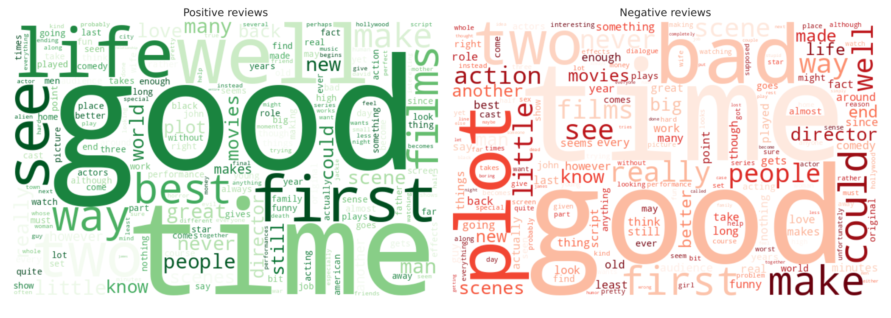

# CodeAlpha_SentimentAnalysis — Movie Review Sentiment: VADER vs a Trained Model
Task 4 of the CodeAlpha Data Analytics Internship.

**Objective:** Classify movie reviews as positive/negative and measure how reliable lexicon-based sentiment really is.
**Dataset:** NLTK `movie_reviews` (2,000 reviews, human-labeled 1,000 pos / 1,000 neg).
**Tools:** Python, NLTK (VADER), scikit-learn, WordCloud, Seaborn.

## Results
| Method | Accuracy |
|---|---|
| VADER (lexicon) | 63.5% overall (65.0% on the test split) |
| TF-IDF + Logistic Regression | **81.6%** (same test split) |

- VADER catches 83% of positive reviews but only **44% of negative** ones: it is biased positive, because long reviews mix plot summary, praise and sarcasm.
- The trained model's top negative words: *bad, worst, boring, stupid*; positive: *great, excellent, perfect, best*.
- **Takeaway:** use lexicon tools for short text; train on labeled data for long, domain-specific text.



## Run it
```
pip install -r requirements.txt
jupyter notebook Sentiment_Analysis_MovieReviews.ipynb
```
